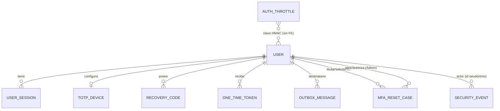
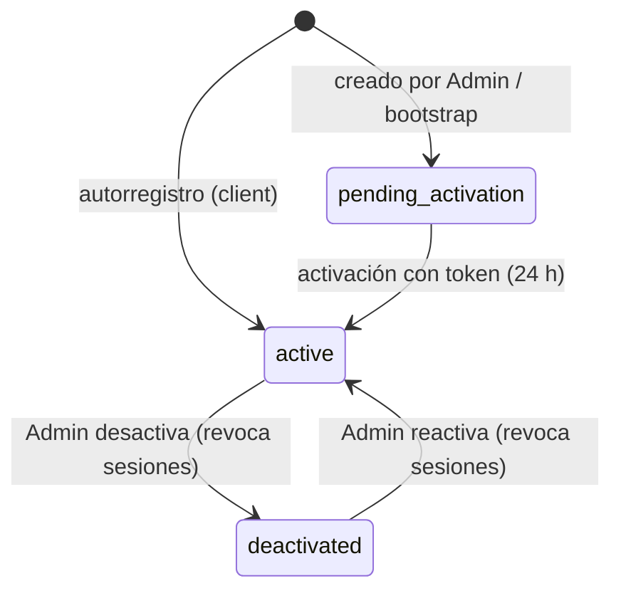
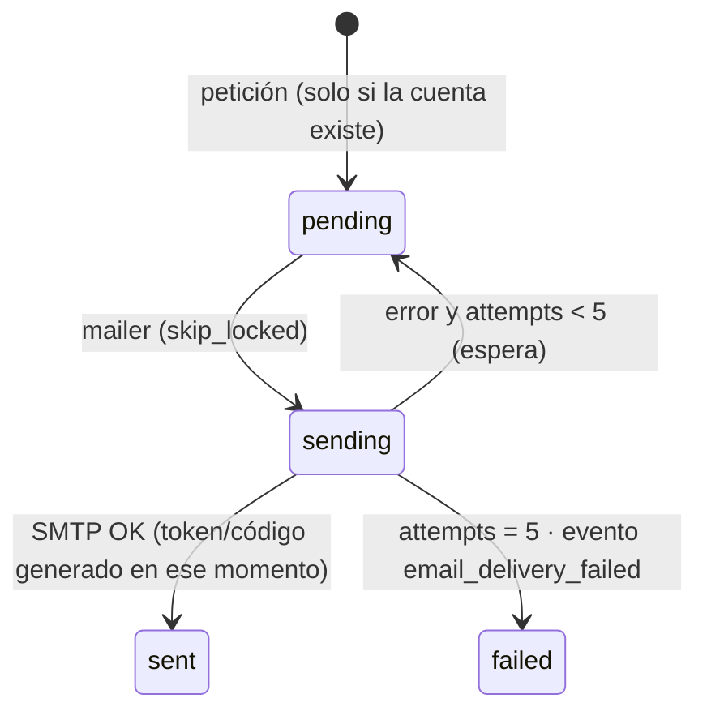
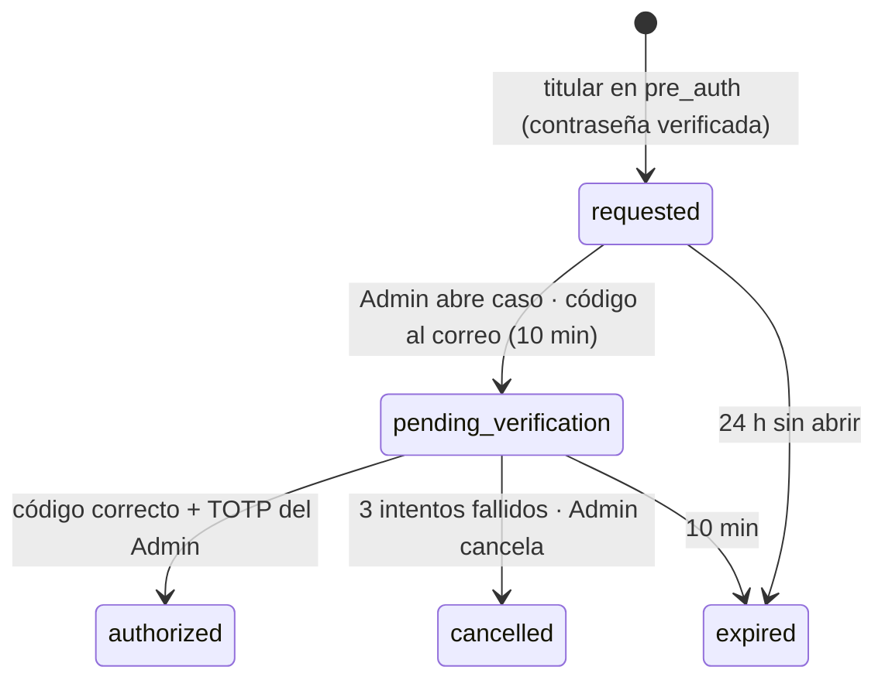

# Data Model: Feature 001 — IAM

**Fecha**: 2026-11-08 (revisión 2) | **Plan**: [plan.md](./plan.md) | **Decisiones**: [research.md](./research.md)

Notas generales:

- Todas las claves primarias son UUIDv4, salvo la de la sesión (verificador HMAC con versión, R2).
- Las marcas de tiempo se guardan en UTC.
- Todo vive en el esquema PostgreSQL `securefin`, cuyo propietario es `securefin_owner` (R14).
- Ningún campo almacena contraseñas, tokens, códigos, identificadores de sesión ni secretos TOTP en
  claro (Principio III). Los campos marcados con 🔒 son verificadores o textos cifrados.
- `Rol` y `Permiso` son una enumeración y una política en código (`iam/policies`).

## Diagrama de relaciones

## Entidades

### User (`iam.User`)

| Campo | Tipo | Reglas |
|---|---|---|
| id | uuid | PK |
| email | varchar(254) | Normalizado a minúsculas; único sin distinguir mayúsculas; ficticio |
| name | varchar(100) | 1–100 caracteres, sin caracteres de control |
| password 🔒 | varchar(128) | Argon2id (m=64 MiB, t=3, p=1); inutilizable en `pending_activation` |
| role | enum | `client` \| `admin` \| `auditor` |
| status | enum | `pending_activation` \| `active` \| `deactivated` |
| created_at / last_login_at / password_changed_at | timestamptz | |

- `mfa_enabled` se deriva de que exista un `TOTPDevice` `active`.
- Sin `is_staff`, `is_superuser` ni grupos (Django Admin desactivado).
- Invariante: al menos un `admin` `active`, comprobado con bloqueo de fila (FR-020).

### UserSession (`iam.UserSession`; sustituye al modelo `Session` de Django)

| Campo | Tipo | Reglas |
|---|---|---|
| key_verifier 🔒 | varchar(72), PK | `"<versión>$" + hex(HMAC-SHA-256(SESSION_HMAC_KEYS[versión], "securefin:session:" + clave))`; como máximo 6 + 1 + 64 = 71 caracteres |
| key_version | varchar(6), índice | `CHECK (key_verifier LIKE key_version \|\| '$%')` |
| session_data | text | Codificado y firmado por Django |
| expire_date | timestamptz, índice | **Caducidad absoluta, nunca extendida**, siempre desde el `created_at` inicial: `created_at + 5/10 min` (`pre_auth`) y `created_at + 8 h` (`full` y demás) |
| public_id | uuid, único | El único identificador expuesto por la API |
| user | FK User, índice | **Propietario en `pre_auth` y en `full`**: desde `_sf_pending_user_id` (`pre_auth`) o `_auth_user_id` (`full`). Solo correlaciona (revocación, expiración y eventos); no autentica ni da permisos (U3) |
| auth_level | varchar(10) | `pre_auth` \| `full`. No se persisten sesiones anónimas (I1) |
| created_at | timestamptz | **Creación inicial de la sesión** y base del límite absoluto de 8 h (FR-011). Se hereda en cada rotación (`pre_auth` → `full`, login y cambios de MFA); ninguna rotación lo reinicia (I3) |
| authenticated_at | timestamptz nulo | Momento del paso a `full`; informativo, sin efecto en la caducidad |
| last_activity_at | timestamptz | **Inactividad de 15 min**: se renueva en el servidor con un `UPDATE` directo (granularidad de 60 s), sin modificar `session_data` ni reemitir la cookie (R2, R13) |
| ip_address | inet nulo | |
| user_agent | varchar(200) nulo | Truncado |

- **No existe ninguna columna con la clave en claro** ni ningún campo `session_key`. El acceso
  heredado por ese nombre falla de forma cerrada.
- La tabla `django_session` no existe (`django.contrib.sessions` no se instala).
- **Sin sesiones anónimas** (I1): `GET /auth/csrf` no crea filas (`CSRF_USE_SESSIONS = False`; la
  cookie CSRF es independiente). La primera fila nace al validar la contraseña: `pre_auth` si hace
  falta MFA y `full` si no. Su `created_at` es el origen del límite de 8 h y se hereda en las
  rotaciones.
- **`_sf_pending_user_id`** (U3): clave interna de los datos de una sesión `pre_auth` que identifica
  al usuario con la contraseña validada y el MFA pendiente. No equivale a autenticación
  (`request.user` es anónimo), no permite acceder a endpoints protegidos y solo se usa para
  correlacionar. `revoke_all(user_id)` borra las filas `pre_auth` y `full` de ese usuario.
- La cookie `__Host-sf_session` solo se emite al crear o rotar la sesión (`SESSION_SAVE_EVERY_REQUEST
  = False`), nunca en cada respuesta.
- `session_expired` se registra solo cuando una fila con `user_id` se encuentra caducada al
  reutilizarse; las cookies sin fila correspondiente no generan eventos.
- Índices: `(user, expire_date)`, `key_version`, `public_id`.

```mermaid
stateDiagram-v2
    [*] --> pre_auth: contraseña válida + MFA activo u obligatorio (primera fila; created_at; _sf_pending_user_id)
    [*] --> full: contraseña válida y sin MFA necesario (primera fila; created_at)
    pre_auth --> full: TOTP / código de recuperación / alta confirmada (rota la clave)
    pre_auth --> [*]: 5/10 min · logout · solicitud de reinicio de MFA
    full --> [*]: 15 min sin actividad (last_activity_at) · 8 h desde el created_at inicial (expire_date) · logout · revocación
```

### TOTPDevice (`iam.TOTPDevice`)

| Campo | Tipo | Reglas |
|---|---|---|
| id | uuid | PK |
| user | OneToOne User | |
| status | enum | `pending` \| `active` |
| secret_ciphertext 🔒 | bytea | AES-256-GCM con etiqueta; AAD = `"securefin:totp:v1:" + user.id` |
| nonce | bytea(12) | Único por cifrado |
| key_version | varchar(6) | `TOTP_ENCRYPTION_KEYS` |
| last_used_timestep | bigint nulo | Antirrepetición |
| created_at / confirmed_at | timestamptz | Un alta `pending` caduca a los 10 minutos |

### RecoveryCode (`iam.RecoveryCode`)

| Campo | Tipo | Reglas |
|---|---|---|
| id | uuid | PK |
| user | FK User | |
| batch_id | uuid | Lote de 10; uno vigente por usuario |
| verifier 🔒 | varchar(128) | Argon2id (m=19 MiB, t=2, p=1) del código normalizado: 28 caracteres en base32 de Crockford, **140 bits** |
| status | enum | `available` \| `used` \| `invalidated` |
| created_at / used_at | timestamptz | |

El consumo es transaccional (`select_for_update`). Regenerar, reconfigurar o reiniciar invalida el
lote anterior.

### OneTimeToken (`iam.OneTimeToken`)

| Campo | Tipo | Reglas |
|---|---|---|
| id | uuid | PK |
| user | FK User | |
| purpose | enum | `account_activation` (24 h) \| `password_reset` (15 min, FR-046) |
| verifier 🔒 | char(64), único | HMAC-SHA-256(TOKEN_HMAC_KEYS[v], purpose + ":" + token) |
| key_version | varchar(6) | |
| created_at / expires_at | timestamptz | Se generan **en la entrega** (outbox, R9) |
| used_at / invalidated_at | timestamptz nulo | |

Estados: `pending` → `used` \| `expired` \| `invalidated`. El canje es transaccional.

### OutboxMessage (`iam.OutboxMessage`; nuevo en la revisión 2)

| Campo | Tipo | Reglas |
|---|---|---|
| id | uuid | PK |
| kind | enum | `account_activation` \| `password_reset` \| `mfa_reset_challenge` \| `mfa_reset_notice` |
| user | FK User | Destinatario (correo registrado) |
| related_id | uuid nulo | p. ej. el `MfaResetCase` |
| status | enum | `pending` \| `sending` \| `sent` \| `failed` |
| attempts | smallint | Máximo 5 |
| next_attempt_at | timestamptz | Espera exponencial |
| created_at / sent_at | timestamptz | |

**No contiene tokens, códigos ni cuerpos de correo**: el secreto se genera y se envía en memoria al
entregar. Las filas `sent` y `failed` se purgan a las 24 h.

### MfaResetCase (`iam.MfaResetCase`)

| Campo | Tipo | Reglas |
|---|---|---|
| id | uuid | PK |
| target_user | FK User | Titular |
| requested_by | FK User | El titular, identificado con su contraseña (sesión `pre_auth`) |
| request_verification | enum | `password` (`console` para *break-glass*) |
| requested_at | timestamptz | |
| opened_by | FK User nulo | Administrador con MFA activo, distinto del titular |
| request_channel | enum nulo | `in_person` \| `course_channel` (canal fuera de banda) |
| opened_at | timestamptz nulo | |
| challenge_verifier 🔒 | varchar(128) nulo | Argon2id del código de 8 caracteres (40 bits); se **borra** al autorizar o cancelar |
| challenge_expires_at | timestamptz nulo | Entrega + 10 min |
| challenge_attempts | smallint | Máximo 3 |
| status | enum | `requested` \| `pending_verification` \| `authorized` \| `cancelled` \| `expired` |
| authorized_by | FK User nulo | Igual a `opened_by`; reautenticado con TOTP |
| authorized_at | timestamptz nulo | |
| verification_method | varchar(64) | `password+email_challenge+out_of_band:<canal>` |

Restricciones: un caso abierto (`requested` o `pending_verification`) por titular; como máximo 3
solicitudes cada 24 h.

### AuthThrottle (`iam.AuthThrottle`)

| Campo | Tipo | Reglas |
|---|---|---|
| id | uuid | PK |
| scope | enum | `account` |
| key_digest 🔒 | char(64) | HMAC(**THROTTLE_HMAC_KEYS**[v], `"throttle:acct:"` + email normalizado); clave exclusiva de este fin |
| key_version | varchar(6) | Versión de `THROTTLE_HMAC_KEYS`; las filas de versiones retiradas se purgan |
| consecutive_failures | int | Se reinicia tras un éxito o tras 30 min sin fallos |
| last_failure_at | timestamptz | |
| blocked_until | timestamptz nulo | 30 s · 2^(n−5), con tope de 900 s, desde n = 5 |

Único: `(scope, key_digest)`. La limitación por IP usa los throttles de DRF con `DatabaseCache`.

### SecurityEvent (`audit.SecurityEvent`, append-only frente a la aplicación)

| Campo | Tipo | Reglas |
|---|---|---|
| id | uuid | PK |
| occurred_at | timestamptz | Índice |
| event_type | enum | Catálogo cerrado; índice |
| outcome | enum | `success` \| `failure` \| `denied` |
| actor_id | uuid nulo | Identificador interno (seudónimo) |
| actor_role | enum nulo | |
| target_type / target_id | varchar / uuid nulo | |
| source_ip | inet nulo | Solo en eventos de autenticación, anomalía y administración |
| request_id | uuid | Correlación con los logs |
| metadata | jsonb | Lista permitida por tipo; claves sensibles prohibidas |

**Catálogo de `event_type`** (32 tipos; cubre FR-040):

| Grupo | Eventos |
|---|---|
| Cuenta | `account_registered`, `account_activated`, `activation_sent`, `account_created_by_admin`, `account_deactivated`, `account_reactivated`, `role_changed` |
| Autenticación | `login_succeeded`, `login_failed`, `logout`, `session_expired`, `sessions_revoked` |
| MFA | `mfa_enabled`, `mfa_disabled`, `mfa_reconfigured`, `totp_rejected`, `recovery_code_used`, `recovery_codes_regenerated` |
| Reinicio de MFA | `mfa_reset_requested`, `mfa_reset_case_opened`, `mfa_reset_authorized`, `mfa_reset_cancelled` |
| Recuperación | `password_reset_requested`, `password_reset_completed`, `password_changed`, `email_delivery_failed` |
| Limitación | `throttle_account_delay`, `throttle_ip_limited`, `credential_stuffing_suspected` |
| Autorización | `authz_denied` |
| Consola | `bootstrap_admin_executed`, `break_glass_executed` |

Emisores que antes no estaban asignados (corrección I1):

| Evento | Emisor | Cuándo |
|---|---|---|
| `account_created_by_admin` | `admin_users.create_privileged_user` | Al crear la cuenta, en su misma transacción |
| `activation_sent` | *Handler* `account_activation` del outbox | Tras entregar con éxito el correo; sin el token |
| `session_expired` | Motor de sesión (`load`) | Solo si una fila con `user_id` se encuentra caducada al reutilizarse; nunca por cookies aleatorias, mal formadas o inexistentes |

## Roles y permisos de PostgreSQL (R14)

| Objeto | `securefin_owner` | `securefin_app` |
|---|---|---|
| Esquema `securefin` | Propietario (CREATE, USAGE) | USAGE (sin CREATE) |
| Tablas `iam_*` | Propietario | SELECT, INSERT, UPDATE, DELETE |
| `audit_securityevent` | Propietario | **INSERT, SELECT**; UPDATE, DELETE y TRUNCATE revocados |
| Triggers de auditoría | Propietario | No puede alterarlos ni eliminarlos |
| Tabla del caché de DRF | Propietario | SELECT, INSERT, UPDATE, DELETE |

El superusuario `postgres` y `securefin_owner` pueden saltarse estos controles: no hay inmutabilidad
absoluta (ver R14).

## Mapeo con las entidades de la spec

| Entidad de la spec | Implementación |
|---|---|
| Usuario | `User` |
| Rol / Permiso | Enumeración `role` + `iam/policies/matrix.py` |
| Sesión | `UserSession` |
| Configuración MFA | `TOTPDevice` |
| Código de recuperación | `RecoveryCode` |
| Reinicio de MFA | `MfaResetCase` |
| Estado de intentos | `AuthThrottle` + caché de DRF |
| Token de un solo uso | `OneTimeToken` (+ `OutboxMessage` para la entrega) |
| Evento de seguridad | `SecurityEvent` |
