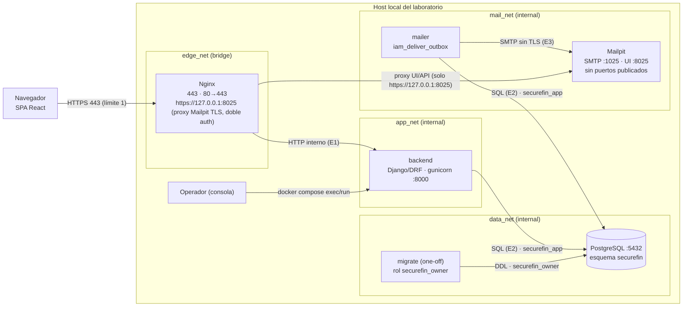
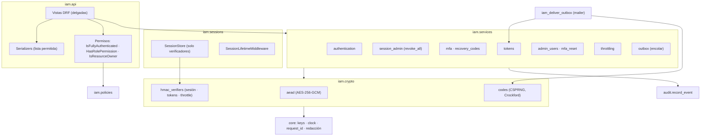
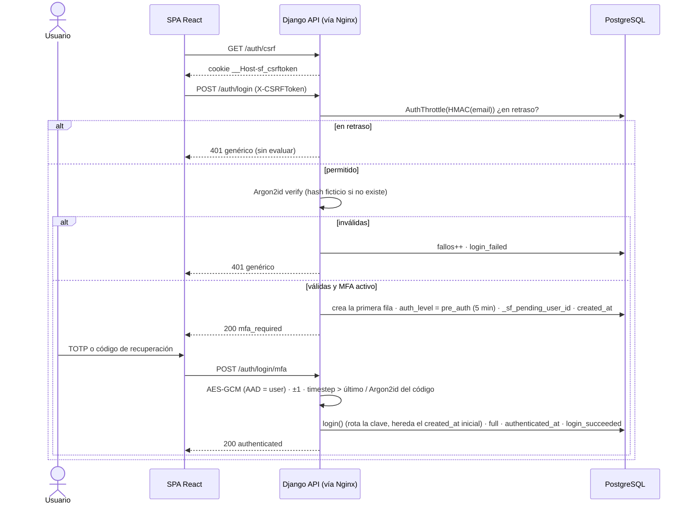
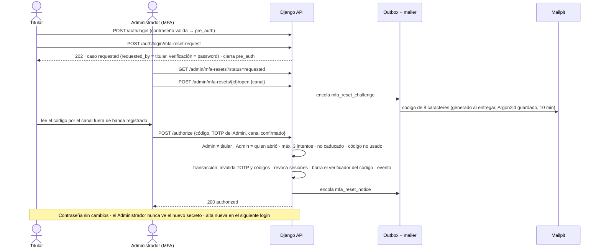

# Implementation Plan: Sistema de Identidad y Control de Acceso (IAM)

**Branch**: `001-iam-access-control` | **Date**: 2026-11-09 (revisión 3) | **Spec**: [spec.md](./spec.md)

**Input**: Feature specification from `specs/001-iam-access-control/spec.md`

**Artefactos**: [research.md](./research.md) · [data-model.md](./data-model.md) ·
[contracts/iam-api.md](./contracts/iam-api.md) · [quickstart.md](./quickstart.md)

## Summary

SecureFin Gateway necesita registro, autenticación con MFA, autorización RBAC (de función y de
objeto), recuperación de acceso y auditoría para tres roles ficticios.

El enfoque técnico, dentro del monolito modular Django REST Framework, es:

- **Sesiones** de servidor con un **motor propio que solo persiste verificadores HMAC-SHA-256
  versionados** del identificador. El modelo no tiene ninguna columna en claro y la tabla
  `django_session` no existe. La cookie es `__Host-` `HttpOnly`/`Secure`/`SameSite=Strict`, con el
  SPA React en el mismo origen: CSRF nativo y sin CORS. **La cookie solo se emite al crear o rotar
  la sesión**. La inactividad (15 min) se renueva en el servidor mediante `last_activity_at` y la
  caducidad absoluta (8 h) no se extiende nunca (`SESSION_SAVE_EVERY_REQUEST = False`).
- **Claves**: una por propósito criptográfico, todas versionadas y distintas: `SESSION_HMAC_KEYS`,
  `TOKEN_HMAC_KEYS`, `THROTTLE_HMAC_KEYS` y `TOTP_ENCRYPTION_KEYS`, más `DJANGO_SECRET_KEY`.
- **Contraseñas** con Argon2id (m=64 MiB, t=3, p=1), calibrado con una metodología separada:
  argon2-cffi para el coste criptográfico y Apache Benchmark para la carga del endpoint.
- **TOTP** cifrado con AES-256-GCM.
- **Códigos de recuperación** de 140 bits con verificador Argon2id.
- **Tokens** de 256 bits con verificador HMAC y clave versionada; el fragmento de la URL se limpia en
  React.
- **Correos** mediante un **outbox sin secretos** entregado por un proceso `mailer` hacia Mailpit, en
  una red interna sin salida. Así desaparece el oráculo de enumeración que dependía del buzón.
- **Reinicio de MFA** con tres elementos verificables: contraseña, posesión del correo y canal fuera
  de banda, más el TOTP del Administrador.
- **Auditoría** append-only frente al rol de ejecución, con roles de PostgreSQL separados.
- **Primer y último Administrador** solo por consola.

## Technical Context

**Language/Version**: Python 3.13 (preliminar); Node.js 22 LTS solo para compilar el frontend.

**Primary Dependencies**:
- Backend: Django 5.2 LTS (última versión de mantenimiento, al menos 5.2.17); DRF (3.18.x si supera
  los criterios de R17, si no la última 3.16.x); argon2-cffi, cryptography, pyotp, segno, psycopg 3,
  gunicorn.
- Frontend: React 19, Vite, react-router.
- Bloqueo: pip-tools con hashes, `npm ci` e imágenes por *digest* (R17).

**Storage**: PostgreSQL 17, esquema `securefin`, con los roles `securefin_owner` (migraciones) y
`securefin_app` (ejecución; INSERT y SELECT sobre la auditoría). Las sesiones, el outbox y el caché
de limitación también están en PostgreSQL. Sin Redis.

**Testing**: pytest, pytest-django y pytest-cov; suite de conformidad del motor de sesión; Postman y
cURL; Apache Benchmark y `python -m argon2`; **Playwright obligatorio** como dependencia de
desarrollo para las pruebas E2E del navegador (TS-E01 y TS-S24). En CI, trabajos separados `static`,
`unit`, `integration` y `stack` (este último con Docker Compose, healthchecks y secretos efímeros):
Semgrep y Bandit, pip-audit y npm audit, y Trivy.

**Target Platform**: contenedores Linux con Docker Compose en el host local; navegador moderno.

**Project Type**: aplicación web (API + SPA) en monolito modular.

**Performance Goals**: login p95 inferior a 2 s con 20 concurrentes (SC-010); medir y documentar el
hash aislado, la memoria y la CPU (R4).

**Constraints**:
- TLS 1.2 o superior entre el cliente y Nginx.
- Δ de tiempo de enumeración inferior a 100 ms (NFR-003).
- Backend, mailer y Mailpit sin salida a Internet.
- Identidades ficticias.
- Sin Redis ni microservicios.
- Parámetros de Argon2id no reducibles sin aprobación.

**Scale/Scope**: laboratorio académico con decenas de usuarios ficticios; unos 31 endpoints y 7
comandos de consola.

## Constitution Check

*GATE: Must pass before Phase 0 research. Re-check after Phase 1 design.*

| Principio | Exigencia | Cumplimiento | Pre | Post |
|---|---|---|---|---|
| I. STRIDE | Antes de implementar; mitigación → criterio → prueba | 40 amenazas en "STRIDE Threat Model" | ✅ | ✅ |
| II. Autenticación y control de acceso | Argon2id; MFA para roles privilegiados; RBAC de función y de objeto; sesión justificada; CSRF/CORS; expiración, revocación y fuerza bruta | R2–R4, R12, R13, R15; nivel `pre_auth`; retrasos progresivos | ✅ | ✅ |
| III. Criptografía y secretos | Tabla de primitivas; contraseñas Argon2id; TOTP AES-GCM; tokens HMAC con al menos 128 bits; códigos Argon2id con al menos 64 bits; claves fuera de la base de datos y distintas; sin tokens en claro | R2 (sesiones solo con HMAC; **el identificador no se reemite** en respuestas posteriores a su emisión), R5–R8 (**una clave por propósito**, incluida `THROTTLE_HMAC_KEYS`); los códigos tienen 140 bits | ✅ | ✅ (E1–E3 registradas) |
| IV. API | Serializers estrictos; ORM; Nginx único punto de entrada; cabeceras | Nginx es la única entrada, también de la interfaz de Mailpit; CSP y HSTS | ✅ | ✅ |
| V. Verificación | Pytest con negativas; SAST, SCA y contenedores; falsos positivos | R16; suites TS-U, TS-I, TS-S, TS-SC, TS-C, TS-A, TS-E y TS-P; supresiones con justificación, alcance, responsable, fecha de revisión y aprobación en el PR (`docs/security/suppressions.md`, `.github/pull_request_template.md`) | ✅ | ✅ |
| VI. Auditoría | Eventos mínimos, sin secretos, protegidos | R14; append-only frente a la aplicación; limitaciones documentadas | ✅ | ✅ |
| VII. Privacidad | Ficticios; minimización; finalidad documentada | `docs/security/privacy.md`: finalidad, minimización, acceso, retención y protección de email, nombre, IP, user-agent, identificadores de sesión y eventos (Ley 1581) | ✅ | ✅ |
| VIII. Simplicidad | Monolito; dependencias y componentes justificados; sin Redis | Outbox y `mailer` justificados (R9); pip-tools y Playwright (desarrollo) justificados (R17) | ✅ | ✅ |
| Marco: Mailpit | Sin relay; solo local; mensajes sensibles; retención | R10; sin puertos propios; doble autenticación | ✅ | ✅ |

**Resultado**: el gate se supera. No hay violaciones de prohibiciones absolutas.

**Caducidades alineadas con la spec**: recuperación de contraseña 15 min (FR-046, US7-2),
activación de cuenta 24 h (FR-021) y código de verificación del reinicio de MFA 10 min (R11). Son
independientes entre sí. La discrepancia de la revisión 2 quedó resuelta el 2026-11-09 a favor de
la spec.

## Architecture

### Despliegue, redes y límites de confianza



| Servicio | Redes |
|---|---|
| nginx | `edge_net`, `app_net`, `mail_net` |
| backend | `app_net`, `data_net` (no envía correo: solo encola en el outbox) |
| mailer | `data_net`, `mail_net` |
| migrate | `data_net` |
| db | `data_net` |
| mailpit | `mail_net` |

Nginx no alcanza la base de datos. Solo Nginx publica puertos.

### Responsabilidades del módulo IAM



### Motor de sesión: creación, carga, revocación y rotación (R2)

```mermaid
sequenceDiagram
    participant B as Navegador
    participant MW as SessionMiddleware
    participant ST as SessionStore propio
    participant DB as iam_usersession
    Note over ST: verifier(v,k) = v + "$" + HMAC(SESSION_HMAC_KEYS[v], "securefin:session:" + k)
    B->>MW: petición con cookie k (o sin cookie)
    MW->>ST: load()
    loop versiones aceptadas (activa primero)
        ST->>DB: SELECT … WHERE key_verifier = verifier(v,k)
    end
    alt no encontrada (cookie aleatoria, mal formada, retirada o purgada)
        ST-->>MW: {} y _session_key = None (nunca adopta k) · sin evento
    else caducada (expire_date ≤ now o now − last_activity_at > 15 min)
        ST->>DB: DELETE · session_expired solo si tenía user_id
        ST-->>MW: {} y _session_key = None
    else válida
        ST-->>MW: datos de sesión
        MW->>DB: touch: UPDATE last_activity_at (si han pasado ≥ 60 s) · sin tocar session_data
        Note over MW,B: Respuesta normal SIN Set-Cookie de sesión
    end
    Note over MW: Solo si la sesión se modifica: login()/elevación/cambio de MFA → cycle_key(): nueva k' (256 bits), INSERT verifier(activa,k') con expire_date absoluta, DELETE verifier(k)
    MW->>ST: save() (solo con sesión modificada)
    ST->>DB: INSERT/UPDATE (force_update; si la fila fue revocada → UpdateError, no resucita)
    MW-->>B: Set-Cookie __Host-sf_session=k' (solo en creación o rotación)
    Note over DB: revoke_all(user) = DELETE WHERE user_id = … · retirar versión = DELETE WHERE key_version = 'v1'
```

### Flujo de login con MFA



### Reinicio administrativo de MFA (R11)



## STRIDE Threat Model

Impacto: **A** alto · **M** medio · **B** bajo. T-33 a T-38 son de la revisión 2; T-39 y T-40 son
nuevas en la revisión 3, y en ella se revisaron T-13, T-23 y T-28.

| ID | Componente / flujo | STRIDE | Amenaza | Imp. | Mitigación | Criterio de aceptación | Prueba |
|---|---|---|---|---|---|---|---|
| T-01 | Login | S | Fuerza bruta / relleno de credenciales | A | Argon2id; retrasos por cuenta; throttles por IP; MFA | Como máximo 5 evaluados antes del primer retraso; 0 éxitos durante el retraso | TS-S13 |
| T-02 | Navegador / sesión | S | Robo de sesión por XSS | A | `HttpOnly`; CSP; sin almacenamiento web | Sesión no legible por JS; CSP presente | TS-S04, TS-S19 |
| T-03 | Motor de sesión | S | Fijación de sesión | A | Rotación en cada elevación de nivel; la carga nunca adopta identificadores no emitidos | La clave cambia; una cookie inventada da sesión vacía y clave nueva | TS-SC05, TS-SC06 |
| T-04 | MFA | S | Repetición de TOTP | M | `last_used_timestep` creciente | Repetido → 401 | TS-I09 |
| T-05 | MFA | S | Robo o adivinación de códigos de recuperación | A | 140 bits; Argon2id; un solo uso transaccional; solo desde `pre_auth`; limitación | 0 reutilizaciones; 0 consumos dobles concurrentes | TS-I10 |
| T-06 | Reinicio de MFA | S | Ingeniería social | A | Contraseña + código al correo + canal fuera de banda + TOTP del Administrador + notificación | Ningún reinicio sin los cuatro elementos | TS-S12 |
| T-07 | API | T | Asignación masiva de rol o estado | A | Serializers con lista permitida | Nunca se aplican | TS-S20 |
| T-08 | Tokens | T | Falsificación o alteración | A | 256 bits; HMAC; separación por propósito | → 400 | TS-U06, TS-I11 |
| T-09 | Auditoría | T | Modificación o borrado de eventos por la aplicación | A | Rol sin UPDATE, DELETE ni TRUNCATE; sin propiedad; triggers; modelo | Todas fallan como `securefin_app` | TS-S16, TS-S26 |
| T-10 | Navegador → API | T | CSRF y login CSRF | A | Token + `SameSite=Strict` + origen; `csrf_protect` en las rutas anónimas | Ruta no segura sin token → 403 | TS-S05, TS-S07 |
| T-11 | Administración | R | Negación de acciones | M | Evento transaccional con fallo cerrado | 100 % con evento; fallo de auditoría → revertido | TS-I17 |
| T-12 | Consola | R | Ejecución sin atribución | M | Evento con el usuario del sistema operativo | Evento presente | TS-I14 |
| T-13 | Recuperación / login | I | Enumeración, incluida la temporal dependiente de Mailpit | M | Respuestas idénticas; hash ficticio; **outbox** (sin SMTP en la petición) | Login y recuperación con mismo estado, cuerpo y cabeceras; Δ medio < 100 ms (recuperación con Mailpit activo y detenido) | TS-S27, TS-S09, TS-S14 |
| T-14 | Recursos propios | I | BOLA / IDOR | A | Consultas filtradas por propietario → 404 | 0 accesos ajenos | TS-S02 |
| T-15 | Logs y auditoría | I | Secretos en registros | A | Lista permitida; redacción; fragmento de URL | 0 coincidencias | TS-S17 |
| T-16 | PostgreSQL | I | Filtración de la base de datos | A | Argon2id, HMAC y AES-GCM; claves fuera; sesiones solo con verificador | El volcado no contiene secretos ni identificadores de sesión utilizables | TS-S03, TS-SC14 |
| T-17 | Mailpit | I | Exposición del buzón o de sus tokens (incluidos los artefactos de las pruebas E2E) | A | Sin puertos propios; interfaz y API solo vía Nginx en `https://127.0.0.1:8025` (TLS) con doble autenticación; red interna; retención; E2E sin trazas, vídeos ni capturas y sin artefactos subidos | Puertos inaccesibles; 401 sin credenciales; HTTP plano rechazado en 8025; CI sin artefactos de Playwright | TS-S10, TS-S11, TS-S25 |
| T-18 | Nginx | I | Tokens en logs o `Referer` | M | Fragmento; formato de log sin cuerpos ni cookies; `no-referrer` | 0 tokens en los logs | TS-S08 |
| T-19 | MFA y API | I | Secretos en cachés | M | `no-store` | Cabecera presente | TS-C01 |
| T-20 | Cliente ↔ Nginx | I | Tráfico en claro o TLS débil | A | TLS 1.2/1.3; HSTS; 80→443 | TLS ≤ 1.1 rechazado | TS-S21 |
| T-21 | API | D | DoS con Argon2 | M | Máximo 128 caracteres; límites de cuerpo; throttles; workers acotados | 129 caracteres → 400 sin hash | TS-S22 |
| T-22 | Login | D | Bloqueo de la víctima | M | Tope de 15 min; sin bloqueo rígido | Ningún retraso supera 900 s | TS-S13 |
| T-23 | Recuperación y demás ámbitos anónimos | D | Inundación de solicitudes | B | Throttles por IP por ámbito; un token nuevo invalida los anteriores; retención | Por ámbito: la petición siguiente al umbral da 429 con `Retry-After` y evento | TS-S28 |
| T-24 | API | E | BFLA | A | Matriz por defecto | 100 % de las combinaciones fuera de la matriz denegadas | TS-S01 |
| T-25 | Administración | E | Autoescalado o 0 Administradores | A | Reglas de sí mismo y último Administrador | 403 / 409 | TS-S12, TS-A04 |
| T-26 | Login | E | Saltarse el MFA con `pre_auth` | A | Permiso base `full` | 0 rutas protegidas con `pre_auth` | TS-S15 |
| T-27 | Consola / API | E | Administradores públicos o credenciales por defecto | A | Solo bootstrap, una vez; sin endpoint | Inventario sin creación anónima | TS-I14, TS-S23 |
| T-28 | Claves | E/I | Claves en el repositorio o en imágenes, o una clave compartida entre propósitos | A | Secretos de Compose; una clave por propósito (sesión, tokens, limitación, TOTP); escaneo; validación al arrancar; secretos de CI efímeros | CI limpio; el arranque falla con claves repetidas | CI, TS-U07 |
| T-29 | Cadena de suministro | T/E | Dependencia vulnerable o manipulada | M | Hashes; *digests*; SCA | Sin altas ni críticas | CI |
| T-30 | PostgreSQL | I/E | Acceso directo | A | `data_net` interna; sin puerto; mínimo privilegio; owner fuera del contenedor de ejecución | 5432 inaccesible; el backend no tiene la credencial owner | TS-S10, TS-S26 |
| T-31 | Django Admin | E | Salto del RBAC | A | Desactivado | `/admin/` de Django → 404 | TS-S23 |
| T-32 | Mailpit | T/I | Relay externo | M | Sin `MP_SMTP_RELAY_*`; red interna | Sin relay; sin salida | TS-S10, TS-S25 |
| T-33 | Motor de sesión | I/S | Compromiso de la clave HMAC de sesión o rotación mal aplicada | M | Clave independiente y versionada; retirada con borrado; entropía de 256 bits | Una sesión de una versión retirada da 401; las nuevas usan la versión activa | TS-SC12 |
| T-34 | Motor de sesión | E | Resurrección de una sesión revocada por carrera | A | `force_update` sin upsert → `UpdateError` | Tras la revocación, ninguna petición en curso recrea la fila | TS-SC11 |
| T-35 | Navegador | I | Token del fragmento en el historial, el almacenamiento o scripts de terceros | M | Lectura inmediata + `replaceState`; solo memoria; CSP `'self'`; sin telemetría; `no-store` | `location.hash` vacío; almacenamiento sin token | TS-S24 |
| T-36 | PostgreSQL | T | Superusuario o propietario manipulan la auditoría | A | Fuera de la aplicación; credenciales separadas; **riesgo residual aceptado** | Documentado (sin prueba automatizable) | — |
| T-37 | Outbox | I/D | Secretos en el outbox o acumulación que bloquea entregas | M | Sin secretos (se generan al entregar); reintentos acotados; purga | 0 secretos en `iam_outboxmessage`; `failed` tras 5 intentos | TS-I18, TS-I12 |
| T-38 | Reinicio de MFA | S/D | Solicitudes fraudulentas o masivas | M | Solo desde `pre_auth` (contraseña); un caso abierto; 3/24 h; throttle por IP | Sin `pre_auth` → 401; 4.ª → 429 | TS-S12, TS-S28 |
| T-39 | Motor de sesión | I | Reemisión del identificador de sesión en respuestas posteriores a su emisión (Principio III) | M | `SESSION_SAVE_EVERY_REQUEST = False`; la inactividad se renueva con `last_activity_at` en el servidor | Ninguna respuesta que no cree ni rote la sesión incluye `Set-Cookie: __Host-sf_session` | TS-SC15, TS-SC16 |
| T-40 | Auditoría | D/R | Inundación del registro con `session_expired` mediante cookies basura | B | El evento solo se emite para filas existentes con `user_id` | Cookies aleatorias o inexistentes → 0 eventos | TS-SC17 |

## Test Strategy

| Capa | IDs | Alcance |
|---|---|---|
| Unitarias | TS-U01–U07 | U01 formato de Argon2id `m=65536,t=3,p=1` · U02 validadores (incluido NFKC) · U03 AES-GCM con AAD · U04 nonces únicos · U05 códigos de 28 caracteres, al menos 128 bits, alfabeto · U06 HMAC por propósito · U07 claves al arrancar |
| Integración | TS-I01–I19 | **I19 purga controlada** (`iam_purge_expired`: no borra limitaciones con retraso vigente ni con fallos recientes de una versión aceptada; T138) · Registro, login, logout, `/auth/session`, rotación, inactividad, absoluta, matriz de revocación, TOTP repetido, códigos (con concurrencia), tokens, buzón caído, entrega solo en el buzón, consola, retrasos, anomalías, fallo cerrado de auditoría · **I18 el outbox no contiene secretos**. En I11 se verifican por separado las caducidades: recuperación 15 min, activación 24 h y código de reinicio de MFA 10 min (reloj simulado; aceptado justo antes del límite y rechazado justo después) |
| **Conformidad del motor de sesión** | **TS-SC01–SC20** | Ver la tabla siguiente |
| Seguridad | TS-S01–S28 | **S27 tiempos y respuesta del login** (existente con contraseña errónea frente a inexistente) · **S28 límites por IP parametrizados**: login, mfa, register, activation y mfa_reset_request en US5 (T132); recovery en US7 (T137) · Matriz rol × endpoint, BOLA, secretos en la base de datos, cookies, CSRF, sin CORS, origen ajeno, tokens en logs, tiempos (Mailpit activo **y detenido**), aislamiento, autenticación de la interfaz, abusos del reinicio, fuerza bruta, inexistentes, `pre_auth`, inmutabilidad, escaneo de secretos, separación de funciones, CSP, asignación masiva, TLS, entradas enormes, inventario de rutas · **S24 limpieza del fragmento en el navegador** · **S25 inventario de redes de Compose** · **S26 privilegios de PostgreSQL (ALTER, DROP TRIGGER, credencial owner ausente)** |
| Contrato | TS-C01 | [contracts/iam-api.md](./contracts/iam-api.md) |
| E2E (Playwright) | TS-E01–E03, TS-S24 | Cada historia prueba solo sus formularios (I1). Atributos `autocomplete`, pegado permitido, `<form>` con `submit` y ningún `maxlength` < 128 (FR-005): **E01** registro y login (US1, T133) · **E02** activación de cuenta (US4, T135) · **E03** recuperación de contraseña (US7, T136) · **S24** limpieza del fragmento con el token (Polish, T122). **Protección de tokens** (U1): trazas, vídeos y capturas desactivados; reporter `list`; sin artefactos subidos; tokens consumidos; mensajes borrados; `down -v`; evidencia textual sanitizada. Los tokens se obtienen con el *fixture* de la API de Mailpit (T139, U2) |
| Aceptación | TS-A01–A07 | Un módulo por historia, con una prueba por escenario |
| Rendimiento | TS-P01, TS-P02 | P01: ab sobre el login (concurrencias 1/5/10/20; p50/p95/p99; `docker stats`) · P02: `python -m argon2` aislado (latencia y RSS) |

**Suite de conformidad del motor de sesión** (marcador `session_conformance`, obligatoria antes de
actualizar Django):

| ID | Verifica |
|---|---|
| SC01 | `iam_usersession` no tiene columna `session_key` ni equivalente; la tabla `django_session` no existe |
| SC02 | Generación: 256 bits, URL-safe; sin colisiones en 10⁴ claves |
| SC03 | Creación: `key_verifier` con formato `v1$[0-9a-f]{64}`, longitud ≤ 72 y restricción `CHECK` de versión |
| SC04 | Captura de **todas** las sentencias SQL (`connection.execute_wrapper`) durante el ciclo csrf → login → MFA → peticiones → logout: el valor de la cookie nunca aparece en el SQL ni en los parámetros |
| SC05 | Sesión inválida: cookie aleatoria, mal formada, de otro entorno o de una versión retirada → sesión vacía, clave nueva y la presentada no se adopta |
| SC06 | Fijación: un identificador presentado antes de autenticarse (inventado o de otro entorno) nunca se adopta; la clave cambia de `pre_auth` a `full` y tras los cambios de MFA |
| SC07 | Actualización: los datos modificados persisten; `expire_date` **no** se extiende (es absoluta) |
| SC08 | Inactividad: 15 min sin actividad según `last_activity_at` (reloj simulado) → 401; actividad cada 10 min durante 1 h → la sesión sigue válida |
| SC09 | Absoluta: 8 h desde el `created_at` inicial con actividad continua → 401; ninguna rotación (`pre_auth` → `full`, login ni cambios de MFA) reinicia `created_at` |
| SC18 | **Origen del límite absoluto** (I3): una sesión creada en `pre_auth` en t₀ y elevada a `full` en t₀ + 9 min → **401 en t₀ + 8 h + 1 s**, aunque haya actividad cada 10 min. La fila `full` tiene el mismo `created_at` que la `pre_auth` y `expire_date = created_at + 8 h`. Una rotación por cambio de MFA en t₀ + 4 h no extiende el límite. La inactividad sigue cortando a los 15 min |
| SC10 | Revocación: `revoke_all`, `DELETE /users/me/sessions/{id}` y logout → la siguiente petición da 401 y la fila no existe |
| SC11 | Concurrencia (`transactional_db`, dos conexiones): revocación durante una petición en curso → `SessionInterrupted` sin resurrección; creaciones simultáneas sin colisión; peticiones paralelas con la misma sesión sin corrupción |
| SC12 | Rotación: tras activar `v2`, las sesiones `v1` siguen válidas y las nuevas usan `v2`; `iam_rotate_session_key --retire v1` → las sesiones `v1` dan 401; rotación de emergencia → todas dan 401 |
| SC13 | API asíncrona → `NotImplementedError`; un acceso heredado por `session_key=` → `FieldError` (fallo cerrado) |
| SC14 | Inspección de PostgreSQL: volcado de `iam_usersession` y de toda la base de datos tras la suite, buscando cada cookie emitida → 0 coincidencias; `session_data` no contiene la clave |
| SC15 | **Sin `Set-Cookie` innecesario**: en GET y POST autenticados que no modifican la sesión, ninguna respuesta incluye `Set-Cookie: __Host-sf_session`. Solo aparece al crear la sesión, en el login, en la elevación de `pre_auth` a `full`, tras los cambios de MFA (rotación) y en el logout o la revocación (borrado) |
| SC16 | **Renovación sin modificar el contenido**: tras una petición autenticada con ≥ 60 s desde la anterior, `last_activity_at` avanza mientras `session_data`, `expire_date` y `key_verifier` quedan idénticos byte a byte y `request.session.modified` es falso |
| SC19 | **CSRF sin sesiones** (I1): `GET /auth/csrf` y un login fallido crean **0** filas `UserSession` y no emiten `Set-Cookie: __Host-sf_session`. Un POST anónimo sin `X-CSRFToken` sigue dando 403 y con el token válido se procesa, sin crear sesión si las credenciales fallan |
| SC20 | **Usuario pendiente** (U3): una sesión `pre_auth` guarda `user_id` desde `_sf_pending_user_id`, mantiene `request.user` anónimo y da 401 en rutas protegidas. `revoke_all(user)` borra tanto sus filas `pre_auth` como `full`. `pre_auth` caduca a los 5 min (10 en un alta obligatoria) |
| SC17 | **`session_expired`**: una sesión válida (con `user_id`) caducada por inactividad o por el límite absoluto, al reutilizarse → exactamente 1 evento con su motivo. Cookies aleatorias, mal formadas, inexistentes o de sesiones ya purgadas → 0 eventos |

**Trazabilidad con los criterios de éxito**:

| Criterio | Prueba |
|---|---|
| SC-001 | Medición manual cronometrada (T125) |
| SC-002 | TS-S01, TS-S02 |
| SC-003 | TS-S03, TS-S17, TS-SC14 |
| SC-004 | TS-S13 |
| SC-005 | TS-S15, TS-A03 |
| SC-006 | TS-I16, TS-S17 (31 tipos) |
| SC-007 | TS-I10, TS-I11 |
| SC-008 | TS-S12, TS-A04 |
| SC-009 | TS-I13 |
| SC-010 (= NFR-002) | TS-P01 |
| SC-011 | `docs/security/` + matriz FR → prueba de `/speckit-tasks` |

**Pipeline de CI** (en cada PR; trabajos separados, R16):

1. **`static`**: Semgrep (con reglas propias para `session_key`, `csrf_exempt` y CORS), Bandit,
   pip-audit `--require-hashes`, npm audit y Trivy `fs`.
2. **`unit`**: `pytest -m unit`, sin base de datos.
3. **`integration`**: servicio PostgreSQL con los dos roles; `integration`, `session_conformance`,
   `security`, `contract` y `acceptance`, excluyendo `stack`, con cobertura.
4. **`stack`**:
   - genera secretos **efímeros** con `openssl rand -base64 32` (incluidas las cinco claves y las
     contraseñas de los roles), sin secretos reales ni versionados;
   - `docker compose up -d --wait`, que espera a los healthchecks;
   - `docker compose run --rm migrate`;
   - `pytest -m stack`, `npx playwright test` y Trivy `image`;
   - `down -v`.

Ninguna prueba se omite en silencio: `--strict-markers`, fallo (no omisión) si el stack no responde,
y fallo del trabajo si se recogen 0 pruebas. Falla con severidad alta o crítica; las supresiones
siguen `docs/security/suppressions.md` con aprobación en el PR.

## Project Structure

### Documentation (this feature)

```text
specs/001-iam-access-control/
├── plan.md              # Este archivo
├── research.md          # Decisiones R1–R17
├── data-model.md        # Entidades, estados, roles de PostgreSQL y catálogo de eventos
├── quickstart.md        # Validación V1–V18, infraestructura y calibración
├── contracts/
│   └── iam-api.md       # API, rutas con token, consola y correos
├── checklists/
│   └── requirements.md
└── tasks.md             # Fase 2 (/speckit-tasks; NO lo crea este comando)
```

### Source Code (repository root)

```text
backend/
├── config/                       # settings (base, lab, test), urls, wsgi
├── apps/
│   ├── core/                     # keys, clock, request_id, log redaction
│   ├── iam/
│   │   ├── models/               # user, session, mfa, tokens, outbox, throttle, mfa_reset
│   │   ├── sessions/             # store.py (motor propio), middleware.py (lifetime)
│   │   ├── services/             # authentication, session_admin, mfa, recovery_codes, tokens,
│   │   │                         # admin_users, mfa_reset, throttling, outbox
│   │   ├── crypto/               # aead, hmac_verifiers, codes
│   │   ├── policies/             # matrix, password_validators, blocklist
│   │   ├── api/                  # serializers, views, permissions, urls
│   │   └── management/commands/  # iam_bootstrap_admin, iam_break_glass, iam_deliver_outbox,
│   │                             # iam_rotate_totp_key, iam_rotate_session_key, iam_purge_expired
│   └── audit/                    # models, services, api, migrations (grants + triggers)
├── requirements.in / requirements.txt   # pip-tools con hashes
└── tests/ (unit, integration, session_conformance, security, contract, acceptance)

frontend/
├── src/
│   ├── api/                      # fetch same-origin + X-CSRFToken
│   ├── pages/                    # register, login, mfa, enroll, reset, activate, profile,
│   │                             # sessions, admin, audit
│   └── lib/fragmentToken.js      # lectura + replaceState (R7)
├── tests/e2e/                    # Playwright: password-fields, fragment-token (TS-E01, TS-S24)
├── playwright.config.js
└── package.json / package-lock.json   # @playwright/test solo en devDependencies

infra/
├── nginx/                        # TLS, cabeceras, limit_req, /api, proxy TLS de Mailpit (https://127.0.0.1:8025)
├── postgres/                     # init: roles securefin_owner y securefin_app, esquema
└── compose.yaml                  # 4 redes, 6 servicios, secretos, imágenes por digest

.semgrep/                         # reglas propias
.github/workflows/ci.yml          # trabajos static, unit, integration y stack
.github/pull_request_template.md  # supresiones y excepciones con aprobación
docs/security/                    # un documento por mecanismo (FR-049), privacy.md, suppressions.md
secrets/                          # en .gitignore
```

**Structure Decision**: aplicación web con `backend/` (apps `core`, `iam` y `audit`), `frontend/`
(SPA servida por Nginx desde el mismo origen) e `infra/`. La infraestructura se crea durante la
implementación, por tareas.

## Complexity Tracking

Excepciones según la Gobernanza. Responsable: el titular del proyecto SecureFin Gateway.

| ID | Desviación | Justificación | Riesgo residual | Control compensatorio | Revisión o cierre |
|---|---|---|---|---|---|
| E1 | Nginx → gunicorn por HTTP (Principio III) | `app_net` interna; no cruza un límite de confianza | Un contenedor comprometido en `app_net` podría observar tráfico | Red interna; backend no publicado; solo dos miembros | Al cerrar la Feature 001 o antes de cualquier despliegue fuera del host local |
| E2 | backend/mailer → PostgreSQL sin TLS (Principio III) | `data_net` interna | Igual que E1 | Igual que E1, más un rol de mínimo privilegio; Nginx fuera de `data_net` | Igual que E1 |
| E3 | mailer → Mailpit por SMTP sin TLS (Principio III; previsto en el Marco de la constitución) | Buzón local en `mail_net` interna | Tokens y códigos en tránsito interno | Red interna; un solo uso y vida corta; sin relay ni puertos publicados | Igual que E1 |

**Complejidad justificada (no son violaciones)**:

| Elemento | Motivo | Alternativa más simple rechazada |
|---|---|---|
| Motor de sesión propio (R2) | Prohibición absoluta de tokens en claro; revocación por usuario | El modelo `Session` de Django guarda `session_key` en claro |
| Outbox + `mailer` (R9) | Elimina el oráculo de enumeración dependiente de Mailpit y da resiliencia; sin secretos persistidos | Envío síncrono (oráculo con Mailpit lento) e hilos manuales (rechazados) |
| Roles de PostgreSQL separados (R14) | Impedir que la aplicación modifique la auditoría | Solo trigger y modelo (el rol propietario podría desactivarlos) |
| Cuatro redes de Docker (R10) | Mínimo privilegio de red: Nginx sin base de datos y Mailpit aislado | Una red interna única |
